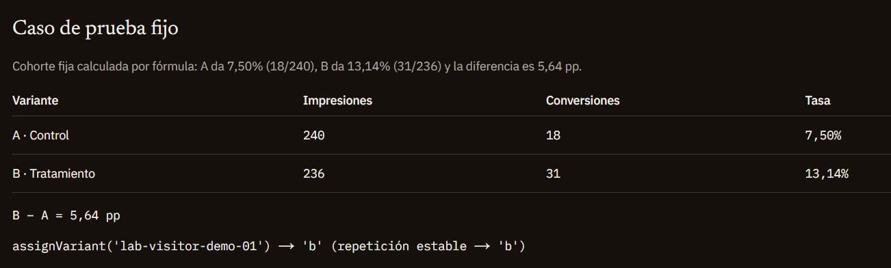

# practica-esqueleto-test-ab-metrics-seo
Abajo del todo, agregue mi parte, dando los informes del laboratório.

This is a [Next.js](https://nextjs.org) project bootstrapped with [v0](https://v0.app).

## Built with v0

This repository is linked to a [v0](https://v0.app) project. You can continue developing by visiting the link below -- start new chats to make changes, and v0 will push commits directly to this repo. Every merge to `main` will automatically deploy.

[Continue working on v0 →](https://v0.app/chat/projects/prj_doZJN4YzGEwGJ1oaIqLMCknlQsWa)

## Getting Started

First, run the development server:

```bash
npm run dev
# or
yarn dev
# or
pnpm dev
```

Open [http://localhost:3000](http://localhost:3000) with your browser to see the result.

You can start editing the page by modifying `app/page.tsx`. The page auto-updates as you edit the file.

## Learn More

To learn more, take a look at the following resources:

- [Next.js Documentation](https://nextjs.org/docs) - learn about Next.js features and API.
- [Learn Next.js](https://nextjs.org/learn) - an interactive Next.js tutorial.
- [v0 Documentation](https://v0.app/docs) - learn about v0 and how to use it.


### Informe del trabajo realizado
1. Qué ve una persona asignada a la variante B y qué permanece igual
Una persona asignada a la variante B recibe un mensaje enfocado en la urgencia de la fecha y el límite de vacantes. En pantalla visualiza el titular "El curso empieza el 14 de abril. El cupo, no.", acompañado por la bajada "Doce lugares y una fecha. El mensaje de esta variante apura la decisión, sin cambiar la oferta." y el botón de llamado a la acción "Reservar mi lugar". En el código HTML servido desde el servidor, recibe el title "Abril abre cupos: cursos de oficio en grupos de 12" y la description "El 14 de abril empiezan grupos de doce. En la cohorte anterior, ocho de cada diez consiguieron trabajo en el rubro antes de los noventa días".

2. Qué debería ver un crawler y por qué no constituye cloaking
Un crawler debe recibir siempre la variante A sobre la misma URL /practica. Dado que los rastreadores habitualmente no conservan cookies entre peticiones, realizar un sorteo en cada visita sin cookie provocaría que el buscador indexe títulos y textos inestables en cada rastreo. Esto no constituye cloaking porque no se sirve contenido engañoso ni temáticamente distinto para manipular el posicionamiento en los resultados de búsqueda, sino que se fija la versión de control de la misma oferta comercial bajo la misma URL y el mismo canonical mientras dura la prueba.

3. Por qué la etiqueta canonical no cambia
El atributo canonical apunta siempre de forma fija y limpia a /practica, sin parámetros de consulta. Las variantes A y B representan la misma página y la misma oferta con distinto enfoque de comunicación. Si se publicaran dos rutas separadas o se incluyera la variante dentro de una URL canónica con query, el motor de búsqueda interpretaría que existen dos páginas duplicadas compitiendo por la misma intención de búsqueda, partiendo el experimento y diluyendo la autoridad de indexación.

4. Función de hash utilizada y verificación de estabilidad
Para derivar la variante de manera determinística a partir del identificador del visitante se implementó la función de hash DJB2. Al evaluar el identificador de prueba lab-visitor-demo-01, la función devuelve el valor numérico 3660660871, asignando siempre de forma estable la variante 'b' tanto en la primera ejecución como en cualquier repetición posterior.


### Imagen y explicacion
Aqui tengo las cuentas realizadas
- Variante A (Control): 18 / 240 = 0,075 x 100 = 7,50%
- Variante B (Tratamiento): 31 / 236 = 0,131355... x 100 =(aprox) 13,14%
- Diferencia ($B - A$): 13,14% - 7,50% = 5,64 pp

